# sshs3 — The AI-Native SSH, S3, Storage Cluster & Kubernetes Platform

[](https://github.com/alun-hub/sshs3/actions/workflows/ci.yml)
[](https://github.com/alun-hub/sshs3/releases/latest)

[](https://github.com/alun-hub/sshs3/releases)
[](LICENSE)

> **A modern, security-focused, cross-platform SSH, SFTP, S3 Object Storage, Enterprise Storage Cluster (NetApp ONTAP / StorageGRID / Ceph / ZFS), and Kubernetes platform** — available both as a **Desktop App (Linux & Windows)** and a **Self-Hosted Multi-User Web Server**. Built-in **Collaborative AI Hub**, **S3 Team Workspace Sync (`sshs3-team://` InviteCode)**, **`Ctrl+K` Inline Terminal AI**, **FIDO2 / YubiKey / PKCS#11 Smartcard Authentication**, **Konsole-style Split Terminals**, and a **Dual-Pane File Explorer**.

<p align="center">
  
  <br><em>Konsole-style recursive split panes with independent SSH and local sessions</em>
</p>
<p align="center">
  
  <br><em>Dual-pane file manager for local disk, SFTP, S3 buckets and Kubernetes pods</em>
</p>
<p align="center">
  
  <br><em>Live ephemeral pod debugging (<code>kubectl debug</code>) from the Connection Manager</em>
</p>

---

## 🚀 Why sshs3? (Product Presentation)

Infrastructure, Storage, and DevOps teams typically juggle **5+ disconnected tools**: an SSH client, an SFTP/S3 browser, a Kubernetes dashboard, scattered Wiki runbooks, and external AI chats that have zero context of your live clusters or what your teammates just changed.

**sshs3 unifies the entire workflow into one collaborative workspace:**

| Pillar | What `sshs3` Delivers |
| :--- | :--- |
| **🤖 Context-Aware AI Hub & Full App Control** | Built-in AI agent with complete awareness of your clusters, VMs, S3 buckets, runbooks, and open terminals. Ask anything about `sshs3`, paste screenshots (`Ctrl+V`), or tell the AI to directly add/organize servers, clusters, folders, S3 profiles, schedules, snippets, and settings via `sshs3_*` tools. |
| **🧠 Auto-Memory & Live `TerminalObserver`** | Every notable terminal action (`vim /etc/nginx/...`, `systemctl restart`, `kubectl rollout`, ONTAP `volume modify`, `snapmirror resync`, Ceph/ZFS ops) is automatically logged and distilled into shared **Team Memories & Runbooks** — no manual documentation required. |
| **☁️ S3 Team Workspace & `InviteCode`** | Share your entire server/cluster topology, runbooks, and activity log through your own S3 bucket (AWS S3, NetApp StorageGRID, MinIO, Ceph RGW, R2). Invite teammates with a single `sshs3-team://...` code while **private SSH keys and passwords never leave each user's device**. |
| **🌐 Self-Hosted Multi-User Web Server** | Deploy `sshs3` on any Linux/Windows VM (`npm run start:web`) and access the full experience in the browser with First-Run Admin setup, Invite Tokens, per-user isolated `~/.ssh/id_ed25519` keys, and live multi-user presence. |
| **🔐 Hardware-Grade Zero-Knowledge Security** | Native support for **FIDO2 / YubiKey**, **PKCS#11 Smartcards (SITHS, Net iD, PIV/CAC, OpenSC)**, OS Keyring encryption (`safeStorage`), and YubiKey/PIV-backed Team Vaults. |

---

## 📸 Visual Tour & Product Walkthrough

<details open>
  <summary><b>🤖 1. AI Hub, Cluster Grouping & Inline Terminal AI (Ctrl+K)</b></summary>
  <br>
  <p align="center">
    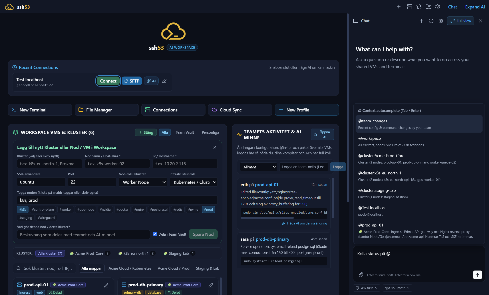
    <br><em><b>Cluster & Node Topology:</b> Group storage controllers (NetApp ONTAP, StorageGRID, Ceph, TrueNAS ZFS), Kubernetes nodes, and VMs into logical clusters with roles, tags, and live activity badges.</em>
  </p>
  <p align="center">
    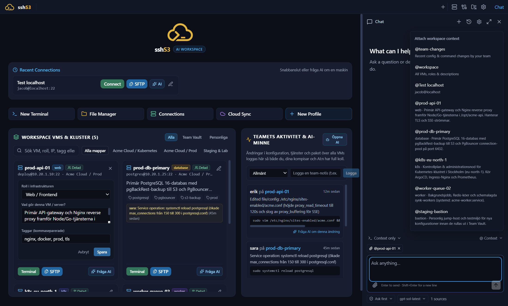
    <br><em><b><code>@</code>-Context Mentions & Local Auth Overrides:</b> Type <code>@cluster:</code>, <code>@node</code>, or <code>@team-changes</code> to inject live infrastructure state into the AI chat. Configure per-developer SSH username/key overrides locally without leaking secrets to S3.</em>
  </p>
  <p align="center">
    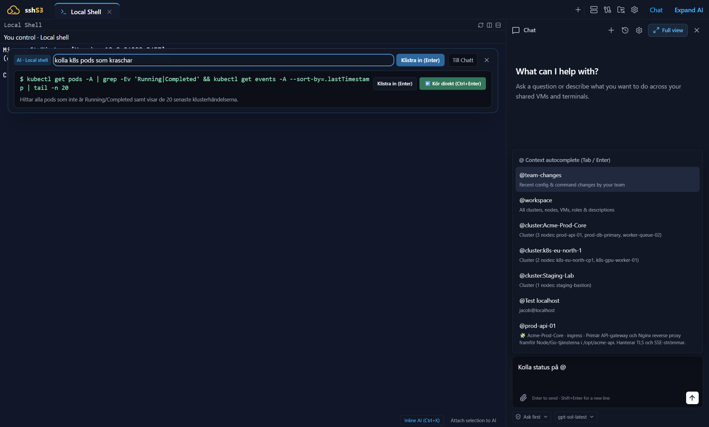
    <br><em><b><code>Ctrl+K</code> Inline Terminal AI:</b> Describe what you want in plain language right inside the terminal to get a command for that shell with a one-sentence explanation — <b>Enter</b> pastes it for you to read and run; <b>Ctrl+Enter</b> runs it at once, but only a single read-only command at an empty prompt. A command that changes something is marked, and pasted, never run for you.</em>
  </p>
  <p align="center">
    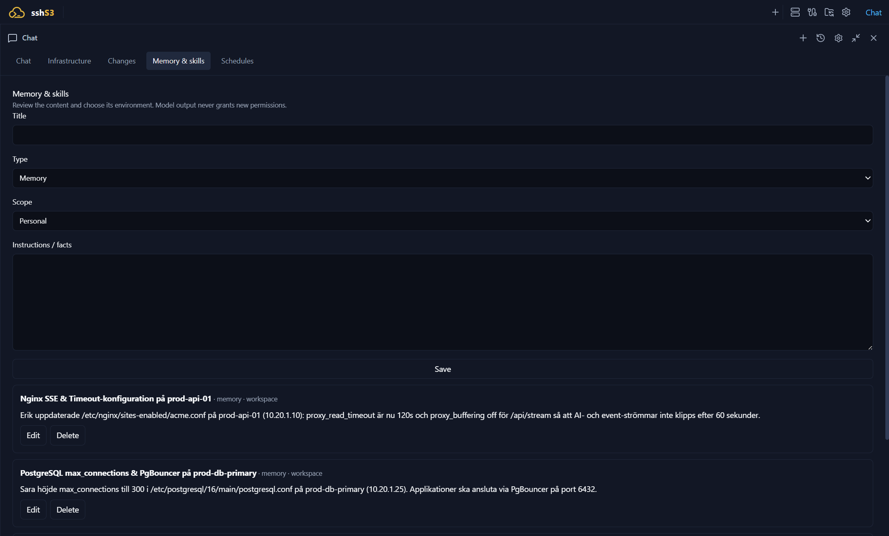
    <br><em><b>Always-On Team Memory & Runbooks:</b> Automatically captured node histories alongside shared troubleshooting skills and storage/infrastructure runbooks.</em>
  </p>
  <p align="center">
    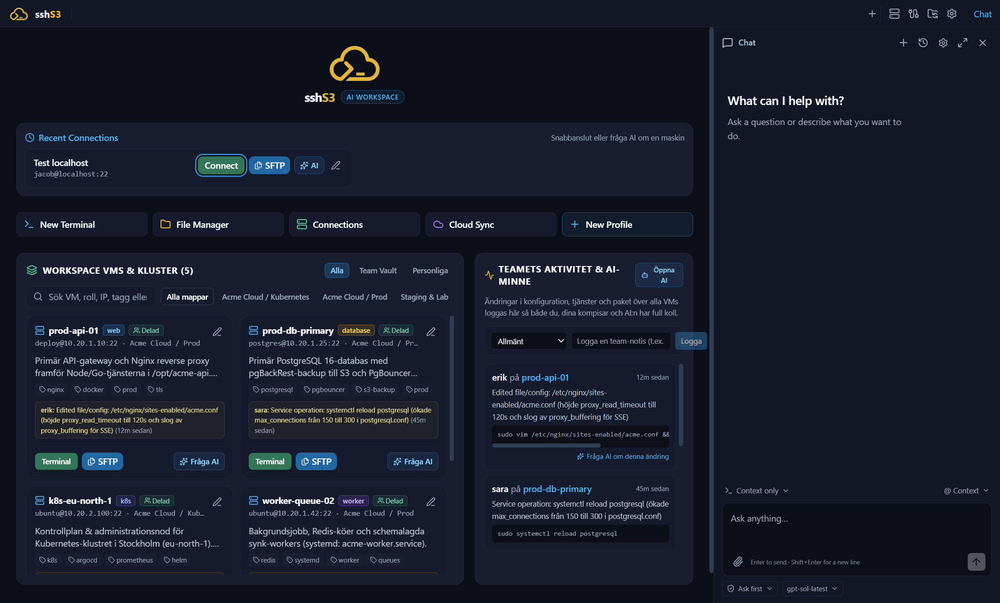
    <br><em><b>Workspace & VMs Dashboard:</b> Real-time feed of team changes across servers and storage clusters alongside the AI assistant.</em>
  </p>
  <p align="center">
    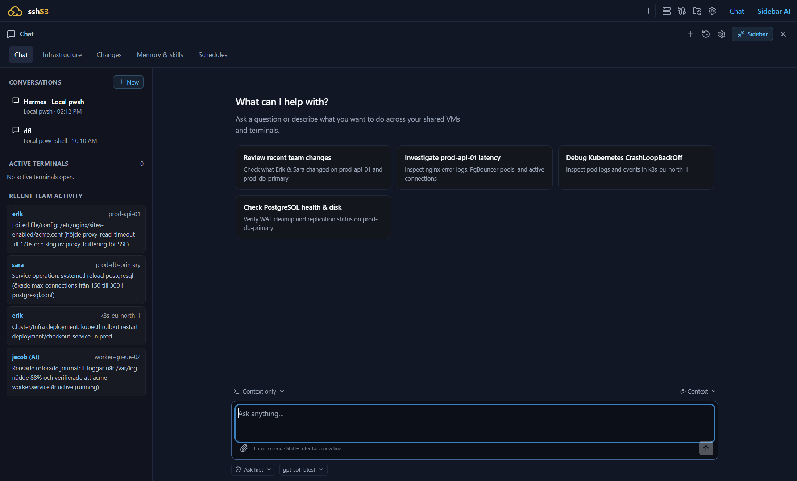
    <br><em><b>Full-Screen AI Hub:</b> Expand the AI workspace for deep multi-node troubleshooting, architectural Q&amp;A, and image/diagram analysis (<code>Ctrl+V</code> screenshot paste).</em>
  </p>
</details>

<details open>
  <summary><b>🌐 2. Self-Hosted Multi-User Web Server & S3 Team Onboarding</b></summary>
  <br>
  <p align="center">
    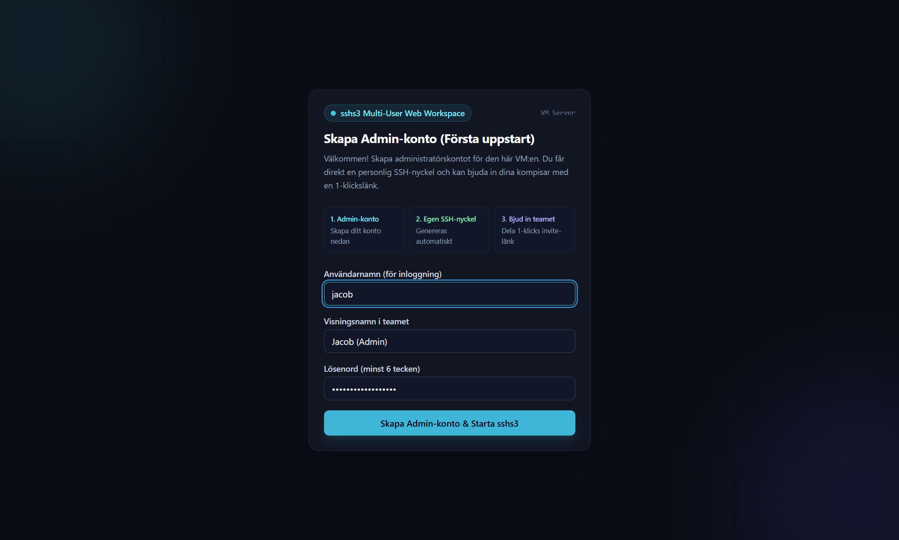
    <br><em><b>Step 1 — First-Run Admin Setup:</b> Deploy <code>sshs3</code> on a VM and open it in any browser. The first visitor creates the Admin account and gets an isolated tenant workspace and dedicated Ed25519 SSH keypair.</em>
  </p>
  <p align="center">
    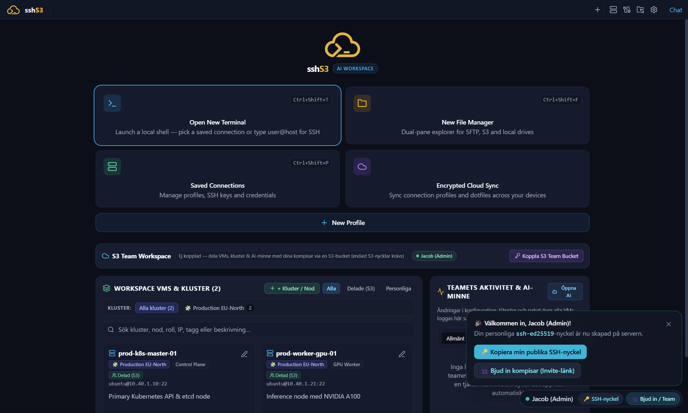
    <br><em><b>Step 2 — Full Browser Workspace:</b> The complete <code>sshs3</code> UI (SSH terminals, SFTP/S3 dual-pane explorer, and AI Hub) runs over an authenticated HTTP + WebSocket bridge.</em>
  </p>
  <p align="center">
    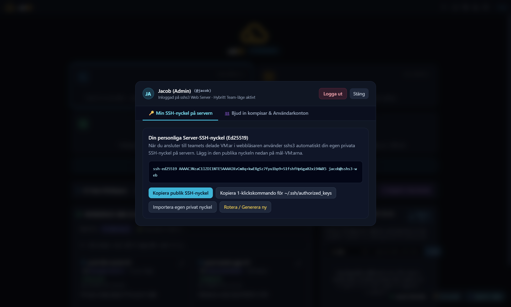
    <br><em><b>Step 3 — Per-User SSH Identity (<code>🔑 Min SSH-nyckel</code>):</b> Every web user gets their own isolated <code>~/.ssh/id_ed25519</code> keypair with one-click copy and a ready-to-run <code>authorized_keys</code> snippet.</em>
  </p>
  <p align="center">
    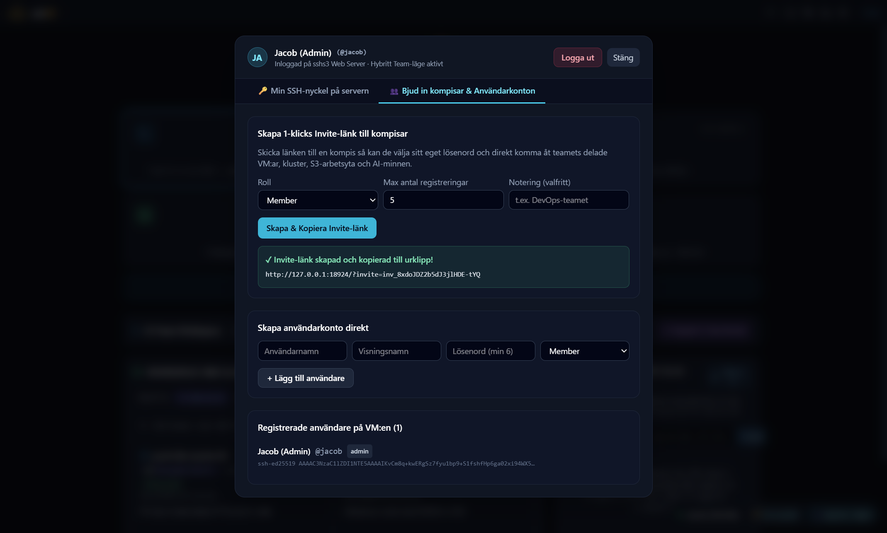
    <br><em><b>Step 4 — 1-Click Team Invites (<code>👥 Team &amp; Inbjudan</code>):</b> Admins generate single-use Web Invite Tokens or copy the <code>sshs3-team://...</code> S3 InviteCode for desktop teammates.</em>
  </p>
  <p align="center">
    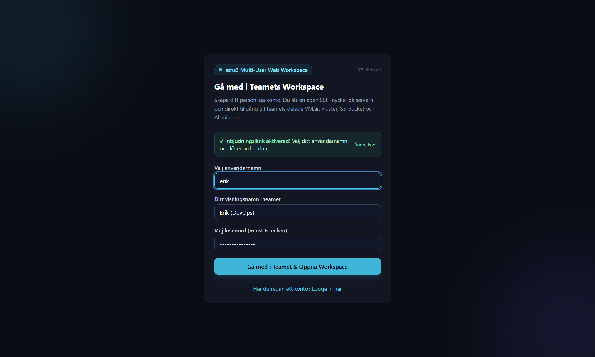
    <br><em><b>Step 5 — Frictionless Teammate Signup:</b> Teammates redeem their invite code in seconds and get their own personal SSH key while automatically joining the shared team workspace.</em>
  </p>
  <p align="center">
    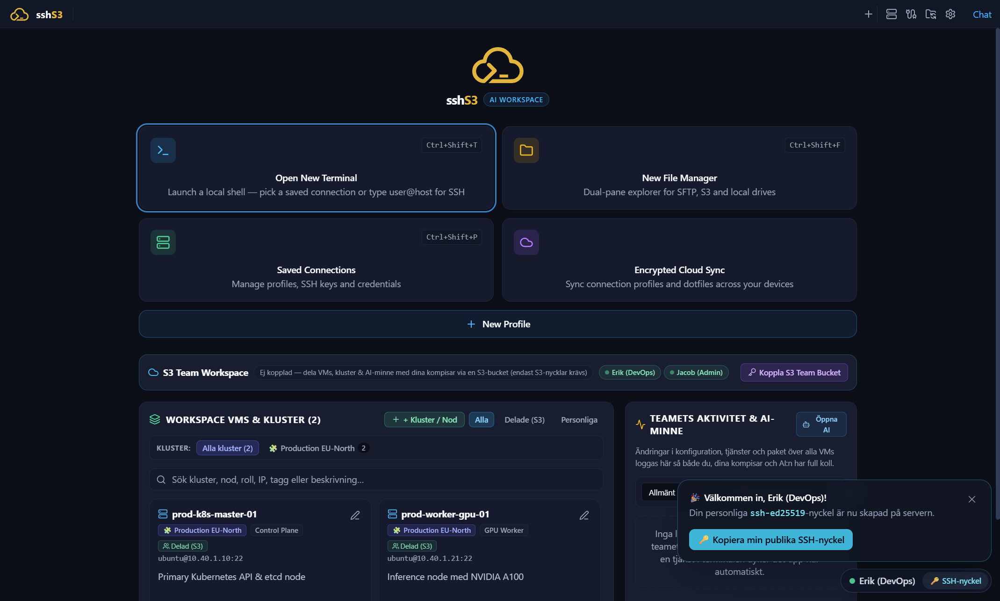
    <br><em><b>Step 6 — Real-Time Multi-User Collaboration:</b> Multiple engineers work simultaneously with live presence indicators, shared clusters, and synchronized AI memories.</em>
  </p>
</details>

---

## Quick Start: Desktop, Demo Mode & Multi-User Web Server

```bash
# 1. Install dependencies
npm install

# 2. Run Desktop App in Enterprise Storage Demo Mode (NetApp ONTAP, StorageGRID S3, Ceph, TrueNAS ZFS, Astra Trident)
SSHS3_DEMO=1 npm run dev

# 3. Build & Start Self-Hosted Multi-User Web Server (on http://localhost:8080)
npm run build:web
SSHS3_DEMO=1 npm run start:web
```

---

## Overview

**sshs3** is an Electron desktop app for sysadmins, DevOps and developers who work across many servers and clusters. Your system's own `ssh` binary drives the terminal and carries SFTP (so `~/.ssh/config`, agents, aliases and jump hosts just work), the AWS SDK talks to any S3-compatible endpoint, and a built-in Kubernetes client handles clusters. See the [Product Comparison Guide](docs/COMPARISON.md) for how it compares with PuTTY, MobaXterm, WinSCP, S3 Browser, Termius and other modern SSH clients (sshpilot, SSH-Studio, RustConn).

## Download

| Platform | Format | Download |
| :--- | :--- | :--- |
| **Linux** | Standalone AppImage | [GitHub Releases](https://github.com/alun-hub/sshs3/releases/latest) (`.AppImage`) |
| **Linux (Debian / Ubuntu)** | DEB package | [GitHub Releases](https://github.com/alun-hub/sshs3/releases/latest) (`.deb`) |
| **Linux (Fedora / RHEL)** | RPM package | [GitHub Releases](https://github.com/alun-hub/sshs3/releases/latest) (`.rpm`) |
| **Linux (Fedora 44)** | COPR repository | `sudo dnf copr enable alun-hub/sshs3 && sudo dnf install sshs3` ([COPR project](https://copr.fedorainfracloud.org/coprs/alun-hub/sshs3/)) |
| **Windows** | Setup Installer (with bundled VcXsrv) | [GitHub Releases](https://github.com/alun-hub/sshs3/releases/latest) (`sshs3-Setup-*.exe`) |
| **Windows** | Portable standalone | [GitHub Releases](https://github.com/alun-hub/sshs3/releases/latest) (`sshs3-*-portable.exe`) |
| **Windows** | Portable ZIP (unpack & run) | [GitHub Releases](https://github.com/alun-hub/sshs3/releases/latest) (`sshs3-*.zip`) |

The app checks GitHub Releases for new versions (switch off under *Settings → App Behavior*, or set `SSHS3_DISABLE_UPDATES=1` for air-gapped machines) and never installs anything without your click. Windows builds are not code-signed yet, so on Windows download new versions manually. The COPR package repackages the same release: every release is built there shortly after it is published, and `dnf upgrade` installs it. If you use it, switch the in-app update check off. Release assets carry `SHA256SUMS` and a build-provenance attestation. Installation steps, requirements (OpenSSH client, keyring, smartcard drivers) and update details: [Installation & Updates](https://docs.sshs3.com/docs/getting-started/).

## What it does

- **Terminal** — real OpenSSH in tabs and recursive split panes, local shells, search, snippets, clipboard history, session restore, clickable links and paths, optional live performance bar. → [Terminal](https://docs.sshs3.com/docs/terminal/), [Performance bar](https://docs.sshs3.com/docs/performance-bar/)
- **File manager** — two panes over local disk, SFTP, S3 and Kubernetes pods; transfer queue, editor with Markdown preview, folder sync and diff, content search, `tail -f`, Git status. → [File manager](https://docs.sshs3.com/docs/file-manager/), [S3 storage](https://docs.sshs3.com/docs/s3-storage/), [Git & developer tools](https://docs.sshs3.com/docs/git-developer/)
- **Kubernetes & OpenShift** — cluster discovery from `~/.kube/config`, exec terminals, logs, pod file explorer, ephemeral debug containers, port forwarding. → [Kubernetes](https://docs.sshs3.com/docs/kubernetes/)
- **Hardware keys & smartcards** — FIDO2 / YubiKey, PKCS#11 (SITHS, Net iD, OpenSC, p11-kit), in-app PIN dialog, three PIN caching modes. → [Security & smartcards](https://docs.sshs3.com/docs/security-smartcards/), [Windows differences](https://docs.sshs3.com/docs/windows/)
- **SSH Certificate Authority (SSH CA)** — On-demand short-lived user certificates via OpenID Connect (OIDC) through Smallstep Step-CA or HashiCorp Vault / OpenBao; supports both in-memory ephemeral Ed25519 keys and hardware tokens (YubiKey or any PKCS#11 / PIV smartcard) with zero private key disk exposure. → [SSH Certificate Authority guide](https://docs.sshs3.com/docs/security/ssh-ca/)
- **Networking** — ProxyJump bastions, saved `-L` / `-R` / `-D` tunnels, outgoing proxies, X11 forwarding with a bundled X server on Windows. → [Networking & tunnels](https://docs.sshs3.com/docs/networking-tunnels/)
- **Profiles & sync** — folders, encrypted secrets at rest, opt-in zero-knowledge sync to your own S3 or SFTP target, dotfiles pool, Team Vault, `~/.ssh/config` kept in sync. → [Connections](https://docs.sshs3.com/docs/connections/), [Sync](https://docs.sshs3.com/docs/sync-environment/), [Team Vault](https://docs.sshs3.com/docs/team-vault/)
- **Keyboard-first** — rebindable shortcuts and mouse-free navigation with `Ctrl+Shift+Arrows`, `Enter` and `Escape`. → [Settings & shortcuts](https://docs.sshs3.com/docs/settings-shortcuts/)

## Documentation

Full user documentation lives at **[docs.sshs3.com](https://docs.sshs3.com)** (source: [`docs/user-guide/`](docs/user-guide/)). Also in this repository:

- [Product Comparison](docs/COMPARISON.md)
- [Architecture notes](docs/user-guide/architecture-internals.md) · [Third-party software](THIRD_PARTY.md)
- [Security Policy](SECURITY.md) — how to report vulnerabilities

## Privacy

sshs3 sends no telemetry, analytics or crash reports. Its only background request is the update check against GitHub Releases, which you can switch off. Private keys on hardware tokens never leave the device, and saved secrets are encrypted at rest with the OS keyring. Details, including exactly how PINs are handled, are in [Security & smartcards](https://docs.sshs3.com/docs/security-smartcards/).

## Contributing

Contributions are welcome! See the [Contributing Guide](CONTRIBUTING.md) for development setup, packaging and release, the [Code of Conduct](CODE_OF_CONDUCT.md), and the [Changelog](CHANGELOG.md) for release history.

## License

This project is licensed under the [MIT License](LICENSE).
