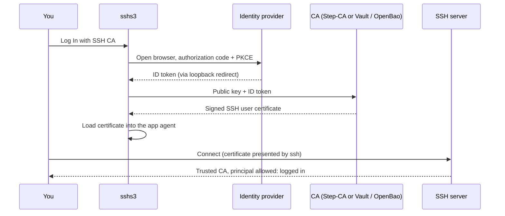

## SSH Certificate Authority (SSH CA)

Sign in once with your company identity provider and sshs3 hands you a short-lived OpenSSH user certificate. There are no long-lived keys to distribute, rotate or revoke on your servers: they trust the CA, and the certificate expires on its own. sshs3 works with **Smallstep Step-CA** and **HashiCorp Vault / OpenBao**, and the private key is either generated in memory for each login or stays on your smartcard.


---

## 1. How It Works

You authenticate with an OpenID Connect (OIDC) identity provider such as Keycloak, Okta, Google Workspace or Microsoft Entra ID. The browser sign-in uses the authorization code flow with PKCE and returns to a loopback address that only sshs3 listens on.



| Step | What happens | Where it runs |
| :--- | :--- | :--- |
| 1 | Sign-in in your default browser | Identity provider |
| 2 | The ID token is exchanged for a certificate | CA |
| 3 | The certificate is used by terminals, SFTP and tunnels that opt in | sshs3 and the system `ssh` |
| 4 | Renewed before it expires, or you sign in again | sshs3 |

> [!NOTE]
> **The CA decides the lifetime and the principals.** The certificate lifetime comes from the CA (the Vault / OpenBao role `ttl`, or the Step-CA provisioner's SSH user duration). **Default Principals** is a request; the CA grants what its policy allows.

---

## 2. Quick Start

1. Prepare your identity provider and the CA (section 3 and 4). This is done once by an administrator.
2. Open *Settings → Security & Smartcard*, scroll to **SSH Certificate Authorities (SSH CA)** and click **Add CA**.
3. Fill in the CA and the identity provider (section 5), click **Save Configuration**, and save the settings dialog.
4. Click **Authenticate with CA** on the new entry. Your browser opens; sign in. The entry shows **Active (your name)**.
5. In a connection profile, set **Authentication** to **SSH Agent** and tick **Use active SSH Certificate Authority session**.
6. Open the connection. The Shield icon in the top toolbar is green while the certificate is valid.

---

## 3. Prepare the Identity Provider

Create an OIDC client for sshs3 with these properties:

| Setting | Value |
| :--- | :--- |
| **Client type** | Public client, authorization code flow with PKCE (S256). sshs3 never sends a client secret. |
| **Redirect URI** | `http://127.0.0.1:<port>/callback`. The port is chosen at random for every login, so the provider has to accept any port on the loopback address (RFC 8252). The IPv6 form `http://[::1]:<port>/callback` is used only if IPv4 loopback is unavailable. |
| **Scopes** | `openid profile email` |
| **Client ID** | The value you enter as **OIDC Client ID** in sshs3. It must match what the CA expects. |
| **Issuer** | The base URL that serves `/.well-known/openid-configuration`. This is the **OIDC Issuer URL**. |

> [!IMPORTANT]
> **A confidential client does not work.** If your provider requires a client secret for the token exchange, the sign-in fails with `OIDC token exchange failed`. Create a separate public client for sshs3.

---

## 4. Prepare the CA and the Servers

### 4.1 Step-CA

Add an OIDC provisioner whose client ID is the one you gave sshs3, and make sure SSH certificates are enabled on the CA:

```shell
step ca provisioner add keycloak --type oidc \
  --client-id sshs3 \
  --configuration-endpoint https://keycloak.example.com/realms/sshca/.well-known/openid-configuration \
  --domain example.com
```

Your `step` version may also ask for `--client-secret`; sshs3 never sends one. sshs3 sends the ID token to `POST /1.0/ssh/sign` as the one-time token, with the certificate type `user` and any **Default Principals** you configured. The provisioner's own `listenAddress` and client secret are only used by Smallstep's CLI; sshs3 runs its own sign-in. Without requested principals, Step-CA derives them from the `email` claim of the token (for `carl@example.com`: `carl` and `carl@example.com`). Templates can add more, for example from a `groups` claim.

### 4.2 Vault / OpenBao

sshs3 logs in to the JWT auth method with the ID token, signs the public key with the SSH secrets engine, and then revokes its own short-lived token. The commands below use `bao`; with HashiCorp Vault use `vault`. The names (`jwt`, `sshs3`, `ssh-client-signer`, `client`, `sshs3-sign`) are examples; use your own and enter the same values in sshs3 (table below).

```shell
# 1. JWT auth method: trust the identity provider
bao auth enable jwt
bao write auth/jwt/config \
    oidc_discovery_url="https://keycloak.example.com/realms/sshca" \
    bound_issuer="https://keycloak.example.com/realms/sshca"

# 2. One role for sshs3 users. bound_audiences must equal the "aud" claim of the ID token,
#    normally the OIDC Client ID. user_claim becomes the user's identity name in Vault.
bao write auth/jwt/role/sshs3 role_type=jwt user_claim=preferred_username \
    bound_audiences=sshs3 token_policies=sshs3-sign token_ttl=2m

# 3. SSH secrets engine as a user CA
bao secrets enable -path=ssh-client-signer ssh
bao write ssh-client-signer/config/ca generate_signing_key=true key_type=ssh-ed25519

# 4. SSH role: the allowed principal is the signed-in user's own name
ACCESSOR=$(bao auth list -format=json | jq -r '."jwt/".accessor')
bao write ssh-client-signer/roles/client -<<EOH
{
  "key_type": "ca",
  "allow_user_certificates": true,
  "allowed_users_template": true,
  "allowed_users": "{{identity.entity.aliases.${ACCESSOR}.name}}",
  "default_user": "{{identity.entity.aliases.${ACCESSOR}.name}}",
  "default_user_template": true,
  "default_extensions": { "permit-pty": "" },
  "ttl": "30m",
  "max_ttl": "1h"
}
EOH

# 5. Policy that lets the sshs3 role sign with that SSH role
bao policy write sshs3-sign - <<'EOH'
path "ssh-client-signer/sign/client" { capabilities = ["create", "update"] }
EOH
```

In sshs3, select **OpenBao / HashiCorp Vault** and enter these values (section 5):

| Field | Value for the example |
| :--- | :--- |
| **CA URL** | The address of the server, for example `https://vault.example.com:8200`. Do not add `/v1`. |
| **OIDC Issuer URL**, **OIDC Client ID** | The issuer and the public client from section 3 (`sshs3` in the example). |
| **Vault Auth Mount** | `jwt` |
| **Vault Auth Role** | `sshs3` |
| **Vault SSH Secrets Mount** | `ssh-client-signer` |
| **Vault SSH Role** | `client` |

**Detect** (section 5) finds the SSH mount and the CA key fingerprint for you.

> [!NOTE]
> **Principals follow the user.** With `allowed_users_template`, the only principal the role allows is the Vault identity name of the signed-in user, which is the `user_claim` of the ID token (`preferred_username`, for example `alun`). A requested principal must be allowed by the SSH role's `allowed_users`. The requested **Default Principals** are sent as `valid_principals`, and the SSH role's `ttl` sets how long the certificate is valid. Without any requested principals, the role's `default_user` is used.

> [!WARNING]
> **Extra principals such as `root`.** To let users request a fixed name too, append it to the list: `"allowed_users": "{{identity.entity.aliases.${ACCESSOR}.name}},root"`. Then everyone who can sign in through that JWT role may request a certificate for `root`. That is fine in a lab; for production, give administrators their own JWT role (restricted with `bound_claims`, for example on a group claim) that points to a separate SSH role.

> [!TIP]
> **Extensions decide what the session may do.** `permit-pty` is enough for a terminal. Add `permit-port-forwarding` for SSH tunnels and `permit-agent-forwarding` for agent forwarding to `default_extensions`, or `allowed_extensions` if users may ask for them.

> [!NOTE]
> **CA key type and versions.** `key_type=ssh-ed25519` for a generated CA key is documented for OpenBao (the example was run on OpenBao 2.7.2); this guide does not state from which release it is available, nor whether your Vault version accepts `key_type` on `config/ca`. If the command is rejected or ignored, leave `key_type` out to get an RSA CA key (and set `algorithm_signer=rsa-sha2-256` on the SSH role, as the Vault documentation does for RSA CAs), or upload your own key pair with `generate_signing_key=false`. An Ed25519 CA key also needs OpenSSH 6.5 or newer on the servers that trust it; if sign-in works but the SSH login fails, check the key type with `ssh-keygen -L -f <certificate>` and the server version first.

> [!NOTE]
> **A private CA for the identity provider.** `bao write auth/jwt/config` checks the issuer when it saves, so the Vault server must be able to reach it. If a private CA signs the provider's certificate, add `oidc_discovery_ca_pem=@/path/to/ca.pem` to that command. Detect finds the auth mount only if you list it for unauthenticated requests: `bao auth tune -listing-visibility=unauth jwt`.

To check the CA before you sign in, read the public key: `curl https://vault.example.com:8200/v1/ssh-client-signer/public_key` returns one `ssh-ed25519 AAAA…` line (no token needed). It is the key your servers must trust (section 4.3), and the same fingerprint that Detect shows.

### 4.3 Your servers

Servers only need to trust the CA's public key. Print it from the CA (Step-CA: `step ssh config --roots`; OpenBao: `bao read -field=public_key ssh-client-signer/config/ca`), save it on the server, for example as `/etc/ssh/ca.pub`, and add it to `sshd_config`:

```ssh-config
TrustedUserCAKeys /etc/ssh/ca.pub
```

By default a certificate is accepted for any principal that equals the login name. To map principals to accounts yourself, use `AuthorizedPrincipalsFile` (see `sshd_config(5)`). No per-user `authorized_keys` entries are needed.

---

## 5. Configure sshs3

Open *Settings → Security & Smartcard* and click **Add CA**. You can define several CAs; **Set as Default** chooses the one that **Log In with SSH CA** in the toolbar uses.


| Field | Meaning |
| :--- | :--- |
| **Name** | Label shown in the list. |
| **Backend Provider** | **Smallstep (step-ca)** or **OpenBao / HashiCorp Vault**. |
| **CA URL** | Base URL of the CA, for example `https://ca.example.com:9000`. A missing scheme is treated as `https://`. |
| **OIDC Issuer URL** | The identity provider's issuer, for example `https://keycloak.example.com/realms/sshca`. |
| **OIDC Client ID** | The public client from section 3. |
| **Key Source** | **Ephemeral in-memory key (Ed25519)** or **Smartcard / PIV (PKCS#11)** (section 7). |
| **Vault Auth Mount** (Vault only) | JWT auth mount. Default `jwt`. |
| **Vault Auth Role** (Vault only) | JWT auth role. Default `default`. |
| **Vault SSH Secrets Mount** (Vault only) | SSH engine mount. Default `ssh`. |
| **Vault SSH Role** (Vault only) | SSH signing role. Defaults to the auth role if empty, then `client`. |
| **Vault Namespace** (Vault only) | Enterprise namespace, optional. |
| **Default Principals** | Comma-separated principals to request, optional. This is only a request; the CA decides what the certificate contains (section 4.1). |
| **Custom Root CA Certificate** | PEM of a private root CA that signs the CA and identity provider, optional. Leave empty if your CA is in the OS trust store. |

### Detect (Step-CA)

For a Smallstep CA, enter the **CA URL** and click **Detect** next to it (or press Enter in the field). sshs3 asks the CA for its OIDC provisioner and fills in **OIDC Issuer URL** and **OIDC Client ID** (and the name, if you have not changed it). If the CA has several OIDC provisioners, you choose one.

| Situation | What to do |
| :--- | :--- |
| The CA's certificate is already trusted by this computer | Nothing more: Detect fills in the fields. |
| The CA uses a private root that this computer does not trust | Detect says so, and a **Root CA fingerprint** field appears. Enter the root's SHA-256 fingerprint, as printed by `step certificate fingerprint root_ca.crt`, and click **Detect** again. sshs3 downloads the root certificate and accepts it only if the fingerprint matches (the same trust step as `step ca bootstrap`). It is then saved in **Custom Root CA Certificate**. |

> [!NOTE]
> **The root is never trusted on first sight.** Without a fingerprint sshs3 does not download anything over an unverified connection; the CA only serves a root certificate for its exact fingerprint. Get the fingerprint from your CA administrator through a channel you trust. The certificate is stored in sshs3 only; it is not added to the OS trust store.

### Detect (OpenBao / HashiCorp Vault)

With **OpenBao / HashiCorp Vault** selected, **Detect** checks the server without a token: it must be reachable, initialized and unsealed. It then looks for an SSH secrets engine at the mounts the server lists, plus `ssh` and `ssh-client-signer`, and fills in **Vault SSH Secrets Mount**. It shows the CA's public key fingerprint (`SHA256:…`) so you can compare it with the key in `TrustedUserCAKeys` on your servers. If a **Vault Namespace** or a **Custom Root CA Certificate** is already entered, Detect uses them.

| Detected | Not detected |
| :--- | :--- |
| The server is Vault or OpenBao and usable | **Vault SSH Role** and **Vault Auth Role** (listing roles needs a token) |
| The SSH secrets engine mount and its CA key | **OIDC Issuer URL** and **OIDC Client ID** (read from the JWT auth configuration, which needs a token) |
| The JWT/OIDC auth mount, only if the administrator lists it for unauthenticated users (`listing_visibility=unauth`) | The server's TLS root: use the OS trust store or paste it |

If several SSH engines or auth mounts are found, you choose one.

**Authenticate with CA** on an entry runs the full sign-in for that CA and reports `Successfully authenticated as <name>! Certificate active.` or the error. It is a real login, not a dry run.

> [!NOTE]
> **Only https, except on loopback.** sshs3 refuses `http://` for the identity provider and CA unless the issuer or CA address is a loopback address (`localhost`, `127.x.x.x`, `[::1]`). That makes local test setups possible without opening the door to plain-text token traffic.

---

## 6. Daily Use

### The status badge


Click the Shield icon in the top toolbar, or focus it and press <kbd>Enter</kbd>. Press <kbd>Escape</kbd> to close the popup.

| Element | What it shows |
| :--- | :--- |
| **Active / Inactive** | Whether a valid certificate is loaded. |
| **User**, **Principals** | The identity and the principals the CA granted. |
| **Valid Until** | Expiry as `yyyy-mm-dd HH:mm`. |
| **Time Left** | Countdown; amber below two minutes, red when expired. |
| **Serial** | The certificate serial number. |
| **Log In with SSH CA** | Starts a sign-in with the default CA (inactive state). |
| **Renew Certificate** | Renews now (active state). |
| **Log Out** | Removes the certificate from the agent and ends the session. |

### Connection profiles


Set **Authentication** to **SSH Agent** and tick **Use active SSH Certificate Authority session**. Terminals, SFTP and file-manager connections, SSH tunnels and *Test connection* then use the active certificate. When no certificate is active, sign in first; the profile does not trigger a sign-in by itself.

### Renewal

- **Automatic:** if the identity provider issues a refresh token, sshs3 renews the certificate about 60 seconds before it expires. It does this silently and never opens a browser by itself. With the smartcard key source the card has to be unlocked: if you locked it, sshs3 asks for the PIN again. If the silent renewal fails, the certificate runs out and the badge shows **Inactive**.
- **Manual:** **Renew Certificate** tries a silent refresh first and falls back to a browser sign-in if that fails.
- **Log Out** also cancels a sign-in that is still waiting in the browser.
- Restarting sshs3 ends the session; sign in again.

---

## 7. Key Sources

| Key Source | Private key | How the certificate is used |
| :--- | :--- | :--- |
| **Ephemeral in-memory key (Ed25519)** | Generated in memory for every login and never written to disk. | Private key and certificate are added to the app agent with a lifetime that ends with the certificate. |
| **Smartcard / PIV (PKCS#11)** | Stays on the card or token (the PIV authentication key, slot 9A, on PIV cards such as a YubiKey). | The card's public key is signed by the CA. The certificate is written to a `0600` file in the app's runtime directory and passed to `ssh` with `-o CertificateFile`; the connection is limited to that card's key. |

The smartcard source works with any PKCS#11 smartcard that exposes an authentication key, not only YubiKeys. sshs3 asks for the card's PIN when you sign in.

> [!WARNING]
> **The smartcard key source unlocks the card for your other profiles under the Global policy**: The key source loads the card into `AppAgent`, the same agent the **Global (App Lifetime)** PIN policy uses. The PIN you entered for SSH CA then also covers every profile that uses this card, until you click **Lock All Now** or quit sshs3. Logging out of SSH CA does not lock the card. Under **Always Prompt** and **Once Per Terminal Connection** your PKCS#11 profiles keep their own prompts. See [Security, Hardware Keys & Smartcards](/docs/security/smartcards/) for the PIN policies.

---

## 8. Security Model

sshs3 checks every certificate before it uses it, and keeps tokens out of storage:

| Protection | Detail |
| :--- | :--- |
| **Sign-in** | Authorization code flow with PKCE (S256), a random `state` and `nonce`. The ID token must carry the same `nonce`, and a different or missing one aborts the login before anything is sent to the CA. |
| **Loopback receiver** | Listens on `127.0.0.1` (or `::1`) only, accepts one callback, checks the `Host` header, and ignores answers with a wrong `state`. |
| **Transport** | https required, certificates verified against the system store or your **Custom Root CA Certificate**. Redirects are not followed, so tokens are not forwarded elsewhere. |
| **Certificate checks** | It must be a user certificate, carry at least one principal, be inside its validity window, and be issued for the exact key sshs3 asked the CA to sign. |
| **Nothing sensitive on disk** | Identity tokens, refresh tokens and the ephemeral private key live in memory only. The PIV certificate file contains the public certificate. |
| **Cancel and logout** | **Log Out** aborts running CA requests and removes the certificate from the agent and the certificate file. |

### Technical Architecture: Where Things Live

`SshCaService` owns the session, installs the certificate and schedules renewal. `oidcFlow` runs the browser sign-in and token refresh, and an operation queue serialises login, renewal and logout. The Step-CA and Vault providers only perform the signing call. Terminals and SFTP receive the agent socket and, for smartcards, the certificate file through the same preparation step as other agent-based profiles.

---

## 9. Troubleshooting & Diagnostics

| Symptom / Error | Probable Root Cause | Corrective Action |
| :--- | :--- | :--- |
| `No SSH CA configuration provided or configured in settings` | No CA is saved. | Add one under *Settings → Security & Smartcard → SSH CA* and save the settings. |
| `Failed to fetch OIDC discovery configuration … (HTTP …)` | Wrong **OIDC Issuer URL**, or the provider is unreachable. | Open `<issuer>/.well-known/openid-configuration` in a browser; use the exact issuer including the realm path. |
| `The CA's certificate is not trusted by this computer` (Detect) | The CA uses a private root that is not in the OS trust store. | Enter the root CA fingerprint and click **Detect** again, or add the root to the OS trust store. |
| `The server's certificate has expired` / `… is not valid for this host name` (Detect) | The CA or Vault server's own TLS certificate is out of date, or the URL uses a name the certificate does not cover. A root fingerprint cannot fix this. | Ask the administrator to renew the certificate, or use the host name it was issued for. |
| `The certificate returned by the CA does not match the fingerprint` | The fingerprint is wrong, or the answer did not come from your CA. | Check the fingerprint with your CA administrator; sshs3 did not trust the certificate. |
| `The server's certificate is not trusted by this computer` (Detect, Vault) | The server uses a private root that is not in the OS trust store. | Paste the root into **Custom Root CA Certificate**, or add it to the OS trust store. |
| `No SSH secrets engine found at ssh or ssh-client-signer` (Detect, Vault) | The engine is mounted elsewhere, or the server hides it from unauthenticated requests. | Enter **Vault SSH Secrets Mount** yourself (`vault secrets list`). |
| `Only https URLs are allowed` | The issuer or CA is `http://` and not a loopback address. | Use https, or run a local test CA on `127.0.0.1`. |
| `Timed out waiting for the browser sign-in …` | The browser sign-in was not finished within two minutes, or the redirect was blocked. | Try again; check that the provider allows `http://127.0.0.1:<port>/callback` for the client. |
| `OIDC token exchange failed: …` | The client is confidential, or the redirect URI is not allowed. | Use a public client with PKCE; allow loopback redirects with any port. |
| `OIDC id_token nonce does not match the sign-in request` | The provider does not return the `nonce` it was sent. | Use a provider or client configuration that returns the `nonce` claim in the ID token. |
| `Step-CA certificate signing failed: …` | The provisioner rejects the token (client ID, domain or SSH disabled). | Match the provisioner's client ID with **OIDC Client ID**; check `domains` and that SSH is enabled. |
| `Vault OIDC login failed: …` | The JWT role rejects the token. | Check `bound_audiences`, `user_claim` and `oidc_discovery_url`; match **Vault Auth Mount** and **Vault Auth Role**. |
| `Vault SSH key signing failed: …` | The token's policy or the SSH role does not allow the request. | Allow `create`, `update` on `<mount>/sign/<role>`; check `allowed_users` for the principals. |
| `SSH CA issued invalid certificate: …` | The CA returned a host certificate, no principals, an expired certificate, or one for another key. | Fix the CA role or provisioner; the message names the reason. |
| `No smartcard detected …` | The smartcard is not inserted, or no PKCS#11 module is available. | Insert the card and install a module such as `opensc` or `libykcs11`. |
| Login succeeds but the server answers `Permission denied` | The server does not trust the CA, or no granted principal matches the login name. | Check `TrustedUserCAKeys`, then compare the badge's **Principals** with the account (`AuthorizedPrincipalsFile`). Use `ssh -v` to see the certificate being offered. |
| `Silent SSH CA renewal failed; sign in again before the certificate expires` (log) | The refresh token was rejected or expired. | Click **Renew Certificate** or **Log In with SSH CA**. |
| Smartcard profiles no longer ask for the PIN after the login | The card was loaded into the shared agent under the Global policy. | Click **Lock All Now**, or use **Once Per Terminal Connection** or **Always Prompt**. |
